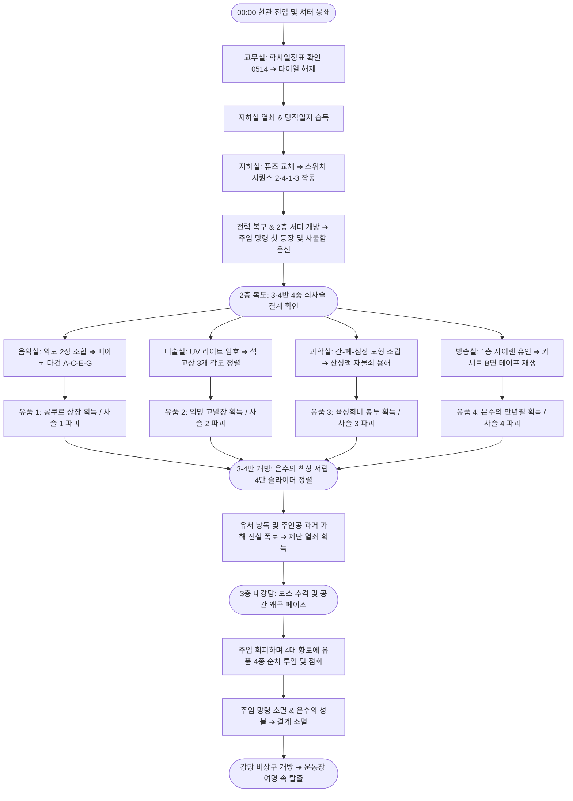

# [1인칭 싱글플레이 공포 방탈출] 붉은 출석부: 닫힌 3학년 4반
## 플레이 타임 35~40분 전체 인게임 상세 진행 흐름서 (No Summary / Full Walkthrough)

- **플레이어 시점**: 1인칭 (주인공 1인 크리에이터 '민우')
- **무대 구성**: 송원고등학교 본관 (1층 로비/행정구역 ➔ 2층 특별교실 및 3-4반 ➔ 3층 강당 제단)

---

### [Phase 00] 00:00 ~ 03:00 | 프롤로그: 진입 및 정문 봉쇄

1. **게임 시작 시점 및 환경**
   - 시점: 1인칭. 폭우가 쏟아지는 자정 직전(23:57). 낡은 정문 철문을 밀고 학교 마당으로 진입.
   - 플레이어 소지품: 구형 건전지식 손전등(배터리 잔량 100%), 방송용 스마트폰(화면 상단 시청자 수 1,420명 및 실시간 채팅창 UI 노출).
   - 조작 안내: `WASD` 보행 이동, `Mouse` 시점 회전, `F` 손전등 토글, `Shift` 달리기.

2. **현관 진입 및 봉쇄 이벤트**
   - 본관 중앙 유리 현관문을 열고 로비로 들어서자마자 괘종시계가 자정(00:00)을 알리며 12번 타종.
   - 굉음과 함께 현관 철제 셔터가 바닥으로 떨어지고, 허공에서 녹슨 쇠사슬 굵은 줄이 셔터를 감싸며 대형 자물쇠가 잠김.
   - 플레이어가 셔터로 다가가 상호작용(`E`)을 시도하면 "두꺼운 쇠사슬로 단단히 감겨 있어 손으로는 열 수 없다." 텍스트 출력.
   - 스마트폰 화면에 강한 지직거림(Glitch) 발생 후 "통신 신호 없음"으로 전환되며 시청자 수가 0명으로 급감.
   - 스피커에서 음산하게 늘어지는 낡은 카세트 테이프 음질의 교가가 송출되기 시작.

---

### [Phase 01] 03:00 ~ 07:00 | 1층 교무실 수색 및 캐비닛 다이얼 퍼즐

1. **1층 복도 탐색**
   - 1층 복도는 칠흑 같은 암전 상태. 천장 형광등은 꺼져 있고, 창문 밖으로 번개가 칠 때마다 복도 그림자가 순간적으로 번쩍임.
   - 바닥 곳곳에 깨진 유리창 파편이 깔려 있어 밟고 지나가면 바삭거리는 소음 발생.
   - 행정실, 보건실 문은 안쪽에서 잠겨 있어 열리지 않음. 교무실 문만 반쯤 열려 있어 진입 가능.

2. **교무실 내부 탐색 및 단서 수집**
   - 교무실 안쪽은 책상과 의자가 난잡하게 흩어져 있음.
   - 첫 번째 책상 서랍을 열어 `예비 AA 건전지 1개` 습득.
   - 벽면 화이트보드에 붉은 보드마카로 갈겨쓴 메모 확인:
     > *"개교기념일 행사 일정표를 확인할 것. 잊지 마라."*
   - 교무실 안쪽 게시판으로 이동하여 먼지 쌓인 액자형 `1999학년도 송원고 학사 일정표`를 손전등으로 비춤.
   - 5월 달력 칸 중 `05월 14일`에 붉은색 원과 함께 "개교 40주년 기념식" 문구 확인.

3. **[퍼즐 1] 교무실 철제 캐비닛 4자리 다이얼 자물쇠**
   - **조작**: 캐비닛 자물쇠에 다가가 `E` 상호작용. 1인칭 집중 모달 뷰로 전환.
   - **기믹**: 마우스 휠이나 클릭으로 4개 다이얼을 회전시켜 숫자 입력.
   - **입력값**: `0 - 5 - 1 - 4` 입력 후 하단 걸쇠 클릭.
   - **결과**: "철컥" 소리와 함께 캐비닛 문이 개방됨.
   - **획득 아이템**:
     - `지하실 철문 열쇠`
     - `1999년 1학기 당직일지`

4. **스토리 문서 열람 (당직일지)**
   - `Tab` 키로 인벤토리를 열고 당직일지 텍스트 확인.
   - 내용:
     > *"1999년 7월 13일 (당직교사: 학생주임 박태식)*
     > *3학년 4반 한은수 관련 재단 감사 건. 교장선생님께선 학교 명예가 실추되면 끝장이라고 하셨다. 입을 열려는 놈들은 전부 제적 처리할 것이다. 오늘 자정, 전교생을 강당에 소집해 특별 정화 조회를 강행한다. 반발하는 학생은 영원히 남겨질 것이다."*
   - 주인공 독백: *"박태식... 어디서 들어본 이름인데? 머리가 왜 이렇게 깨질 것 같지..."*

---

### [Phase 02] 07:00 ~ 12:00 | 지하실 분전반 복구 및 첫 번째 추격전

1. **지하실 진입**
   - 1층 복도 서쪽 끝 굳게 잠긴 철문에 `지하실 철문 열쇠`를 사용하여 개방.
   - 좁은 계단을 내려가면 발목까지 물이 차오른 지하실 통로가 나타남. 걷는 속도가 20% 감소하며 첨벙거리는 발소리 유발.

2. **[퍼즐 2] 지하실 분전반 퓨즈 교체 및 시퀀스 스위치**
   - **상황**: 지하실 벽면 메인 분전반 박스를 열면 주 퓨즈 1개가 새까맣게 타서 끊겨 있고 4개의 레버 스위치가 모두 내려가 있음.
   - **선행 작업**:
     - 지하실 구석 철제 선반 위 공구 상자 안에서 `20A 산업용 원통 퓨즈` 습득.
     - 분전반 빈 소켓에 새 퓨즈를 삽입.
   - **단서 확인**: 분전반 커버 안쪽 부식된 회로 안내 스티커:
     - 1번: 1층 복도 조명 (과전류 위험)
     - 2번: 방송실 및 통신 설비
     - 3번: 2층 중앙 계단 차단 셔터
     - 4번: 배수 펌프 모터
     - 주의 문구: *"역기전류 방지를 위해 통신(2) ➔ 배수(4) ➔ 조명(1) ➔ 셔터(3) 순서로 인가할 것. 순서 위반 시 차단기 강제 트립."*
   - **조작**: 스위치 레버를 `[2번] ➔ [4번] ➔ [1번] ➔ [3번]` 순서대로 클릭하여 올림.
   - **결과**: "우웅-" 하는 대형 변압기 구동음과 함께 본관 전체에 전력이 공급됨. 1층 복도에 어둡고 붉은 비상등이 깜빡이며 켜지고, 계단 쪽에서 철제 셔터가 전동 모터 소리와 함께 올라가는 둔탁한 소음 발생.

3. **괴물 등장 및 은신 튜토리얼**
   - 계단을 타고 1층 복도로 올라오는 순간, 복도 중앙 스피커에서 거친 숨소리가 들리고 복도 끝에서 무거운 군화 발소리와 쇠 끌리는 소리(*찌이익-*)가 접근.
   - **괴물(학생주임 박태식의 망령)** 등장: 얼굴에 붉은 피투성이 천을 칭칭 감고 거대한 1m 철제 잣대를 질질 끌며 순찰 시작.
   - 플레이어 HUD 상단에 소음 반경 UI가 추가되고, 심장 박동음 사운드가 증폭됨.
   - 플레이어는 즉시 `Ctrl`을 눌러 웅크린 상태로 천천히 이동.
   - 바로 옆 청소도구함 사물함으로 다가가 `E`를 눌러 사물함 내부로 숨음.
   - 망령이 사물함 앞을 천천히 지나가며 철 잣대로 사물함 겉면을 긁음.
   - QTE 기믹: "숨 참기 (`Space` 홀드)". 게이지가 다 찰 때까지 스페이스바를 누르고 있으면 망령이 의심을 풀고 교무실 방면으로 멀어짐.
   - 사물함에서 나와 열려 있는 2층 계단으로 질주.

---

### [Phase 03] 12:00 ~ 16:00 | 2층 진입과 결계로 닫힌 3학년 4반

1. **2층 복도 전경**
   - 2층에 올라서면 복도 벽면 전체에 붉은 먹물로 쓴 기괴한 한자 부적이 도배되어 있음.
   - 2층 중앙의 **'3학년 4반'** 교실 출입문 앞.
   - 문은 굵은 쇠사슬 4가닥으로 X자로 칭칭 감겨 있고, 문짝에는 피 묻은 부적 4장이 교차해 붙어 있음.
   - 교실 창문 유리창 안쪽은 짙은 붉은 안개로 가득 차 내부가 보이지 않음.
   - 교실 문 앞 칠판 조각에 남겨진 글귀:
     > *"너희가 빼앗은 노래, 너희가 날조한 고발, 너희가 뒤집어씌운 돈, 너희가 쥐여준 펜... 네 개의 죄를 바쳐라."*

2. **메인 진행 구조 확정**
   - 3-4반을 열기 위해서는 2층의 4개 특별실(음악실, 미술실, 과학실, 방송실)에서 은수에게 누명을 씌웠던 과거의 흔적 4개를 회수해야 함.
   - 주임 망령이 3분 간격으로 계단을 타고 2층 복도를 배회하므로, 방을 오갈 때마다 복도 순찰 타이밍을 확인해야 함.

---

### [Phase 04] 16:00 ~ 20:00 | 음악실 - 찢겨진 악보와 피아노 연주 퍼즐

1. **음악실 탐색**
   - 2층 동편 끝 음악실로 진입. 문을 닫아두면 망령의 시야를 차단할 수 있음.
   - 중앙의 낡은 그랜드 피아노 보면대 위에 찢겨진 오선지 악보의 왼쪽 반쪽이 놓여 있음.
   - 악보 제목: *〈소녀의 기도 - 한은수 작곡〉*. 음표 일부가 뜯겨 나가 판독 불가.
   - 음악실 뒤쪽 악기 수납장 안을 수색하여 넘어진 첼로 케이스 속에서 `찢겨진 악보 오른쪽 조각`을 획득.

2. **[퍼즐 3] 피아노 건반 음계 입력**
   - **조합**: 인벤토리에서 두 악보 조각을 조합하면 완성된 4마디 악보 생성.
   - **단서**: 악보 말미에 적힌 핏자국 메모:
     > *"민우야, 네가 콩쿠르에 네 이름으로 베껴 냈던 그 멜로디... 첫 음들을 기억해? [라 - 도 - 미 - 솔]"*
   - **조작**: 피아노 건반 인터랙션 화면으로 진입. 백건과 흑건이 1인칭 화면 가득 확대됨.
   - **입력**: 건반의 `A4(라) ➔ C5(도) ➔ E5(미) ➔ G5(솔)`을 마우스로 정확히 클릭.
   - **결과**: 정확한 멜로디가 울려 퍼진 후 피아노 전면 공명판 덮개가 덜컥 열림.
   - **획득 아이템**: **[속죄의 유품 1: 콩쿠르 금상 상장]** (수상자 이름에 '김민우'가 적혀 있고 그 위에 붉은 줄이 그어져 있음).
   - **연출**: 피아노 의자가 허공으로 살짝 떴다가 떨어지며 귓가에서 은수의 원망 어린 울음소리 출력. 복도 쪽에서 3-4반 문의 첫 번째 쇠사슬이 끊어지는 굉음 발생.

---

### [Phase 05] 20:00 ~ 24:00 | 미술실 - 석고 데생 각도와 자외선 암호

1. **미술실 수색**
   - 2층 서편 미술실 진입. 이젤마다 검붉은 물감이 튀어 있고 곳곳에 목이 부러진 석고상들이 널브러져 있음.
   - 미술 준비실 철제 서랍에서 `UV 블랙라이트 렌즈 필터` 습득.
   - 기능 추가: `F` 키를 길게 눌러 일반 백색광 모드와 자외선(UV) 암광 모드를 자유롭게 전환 가능.

2. **[퍼즐 4] 3대 석고상 시선 정렬 퍼즐**
   - **상황**: 미술실 중앙 원형 회전판 위에 3개의 석고상(아그리파, 비너스, 다비드)이 올려져 있고, 각 석고상 받침대 아래에 회전 다이얼이 부착되어 있음.
   - **단서 확인**: UV 모드로 전환하여 미술실 동, 서, 북쪽 벽면 캔버스를 비춤.
     - 동쪽 벽 캔버스 형광 낙서: *"비너스는 칠판(북쪽)을 노려본다."*
     - 서쪽 벽 캔버스 형광 낙서: *"아그리파는 창문(남쪽)의 달을 등진다 (즉, 북쪽을 바라봄)."*
     - 남쪽 벽 캔버스 형광 낙서: *"다비드는 비너스를 정면으로 마주한다."*
   - **조작**:
     - 아그리파 받침대를 클릭하여 북쪽(0도)으로 회전.
     - 비너스 받침대를 클릭하여 북쪽(0도)으로 회전.
     - 다비드 받침대를 클릭하여 남쪽(180도)으로 회전시켜 비너스와 마주 보게 세팅.
   - **결과**: 회전판 중앙 바닥이 열리며 숨겨진 소형 금고 노출.
   - **획득 아이템**: **[속죄의 유품 2: 찢겨진 익명 고발장]** (교무실에 은수를 모함하기 위해 투서했던 종이. 주인공 자신의 필적임이 드러남).
   - **이벤트**: 복도에서 주임 망령의 잣대 소리가 미술실 문 앞까지 다가옴. 플레이어는 이젤 뒤 마네킹들 사이에 웅크려 미동 없이 대기하여 위기를 넘김. 3-4반 두 번째 쇠사슬 해제.

---

### [Phase 06] 24:00 ~ 27:00 | 과학실 - 인체 모형 조립과 화학 시약 부식

1. **과학실 진입**
   - 복도 건너편 과학실로 이동. 시약 냄새와 썩은 내음이 진동함.
   - 과학실 중앙 실험대에 투명 아크릴로 된 장기가 비어있는 인체 모형이 세워져 있음.
   - 인체 모형 배 밑의 잠금 장치에 홈 3개가 파여 있음.

2. **[퍼즐 5] 장기 파츠 수색 및 삽입 순서 퍼즐**
   - **장기 탐색**:
     - 개구리 해부 수조 속에서 집게를 이용해 `모형 심장` 습득.
     - 쓰러진 시약장 맨 위 칸에서 `모형 폐` 습득.
     - 구석 싱크대 배수구 안쪽을 조사하여 `모형 간` 습득.
   - **단서 확인**: 칠판에 붙어 있는 낡은 실험 리포트:
     > *"죄악의 침식: 거짓을 삼킨 '간'이 먼저 썩고, 가쁜 숨을 몰아쉬던 '폐'가 굳으며, 마지막으로 뛰던 '심장'이 멈추었다."*
   - **조작**: 인체 모형에 다가가 `[간] ➔ [폐] ➔ [심장]` 순서로 파츠를 클릭하여 장착.
   - **결과**: 모형의 입이 덜컥 벌어지며 `농축 질산 시약병`이 튀어나옴.

3. **약품 혼합 및 사물함 강제 개방**
   - 실험대 위의 `염산 시약`과 `농축 질산 시약`을 3:1 비율로 비커에 조합하여 왕수(강산성 용액) 제조.
   - 과학실 구석에 굵은 자물쇠로 묶인 철제 보관함에 왕수를 부어 자물쇠 부식 후 파괴.
   - **획득 아이템**: **[속죄의 유품 3: 피 묻은 육성회비 봉투]** (당시 도난당했다고 소동이 났던 전교생 성금 봉투. 은수의 가방에 억지로 찔러 넣었던 증거).
   - **공포 연출**: 약품을 집는 순간 천장 환풍구 덮개가 떨어지며 은수의 기괴하게 꺾인 손이 내려와 플레이어의 발목을 낚아채려 함. `Shift`를 연타하여 뿌리치고 교실 밖으로 도주. 3-4반 세 번째 쇠사슬 해제.

---

### [Phase 07] 27:00 ~ 30:00 | 방송실 - CCTV 동선 교란 및 녹음 테이프 재생

1. **방송실 제어 콘솔 수색**
   - 2층 북편 방송실 진입. 여러 대의 CRT 모니터가 켜져 있어 폐교 복도 곳곳을 비추고 있음.
   - 모니터 2번 화면에 주임 망령이 3-4반 바로 앞 복도를 지키고 서 있는 모습이 실시간으로 확인됨 (이대로는 3-4반 접근 불가).

2. **[퍼즐 6] 방송 콘솔 오디오 라우팅 및 유인 기믹**
   - **조작**: 방송 데스크 믹서 패널 조작 화면 진입.
   - **단서**: 벽면의 스피커 회선 배치도 확인.
     - 회선 A: 2층 복도
     - 회선 B: 3층 강당
     - 회선 C: 1층 체육관
   - **실행**:
     1. 회선 셀렉터를 `회선 C (1층 체육관)`으로 돌림.
     2. 마이크 게인 노브를 최대치(+10dB)로 회전.
     3. 믹서 우측의 붉은색 `비상 사이렌 송출 스위치`를 올림.
   - **결과**: 1층 체육관 스피커에서 귀를 찢는 사이렌이 울려 퍼짐. CCTV 모니터 속 주임 망령이 고개를 돌리더니 잣대를 치켜들고 계단을 뛰어 내려가는 모습 송출 (복도 클리어).

3. **카세트 데크 재생**
   - 콘솔 서랍 밑바닥에서 라벨이 뜯긴 `카세트 테이프` 습득.
   - 데크에 넣고 재생 버튼을 누름.
   - **재생 음성**:
     > *(지지직거리는 잡음, 여학생의 울부짖음)*
     > *은수: "선생님, 제발 믿어주세요... 민우가... 민우가 다 꾸민 일이에요..."*
     > *박태식 주임: "입 닥쳐! 재단 이사장님 귀에 들어가면 학교 꼴이 뭐가 돼? 넌 오늘 자정 조회에서 전교생 앞에 무릎 꿇고 네가 도둑질했다고 자백해. 안 그러면 졸업장 따윈 없다!"*
     > *(둔탁한 타격음과 함께 비명 소리 정지)*
   - 데크 카세트 도어가 열리며 **[속죄의 유품 4: 은수의 만년필]** 배출.
   - 복도에서 마지막 네 번째 쇠사슬이 떨어져 나가는 소리가 들리며 3-4반의 봉인이 완전히 풀림.

---

### [Phase 08] 30:00 ~ 34:00 | 3학년 4반 교실 내부 - 진실의 방과 은수의 유서

1. **3-4반 진입**
   - 문을 밀고 들어가자 복도의 소음이 완전히 차단되며, 붉은 안개가 자욱한 교실 내부로 진입.
   - 책걸상 40개가 모두 창문 쪽을 향해 질서정연하게 쌓여 있고, 오직 창가 맨 뒷자리 책상 하나만 온전히 놓여 있음. 책상 위에는 시든 국화꽃 한 송이와 학생증이 놓여 있음.

2. **[퍼즐 7] 은수의 책상 서랍 4단 슬라이드 락**
   - **오브젝트**: 책상 서랍 중앙에 4개의 상징 문양(음표, 편지, 돈, 펜)이 새겨진 원판 슬라이더.
   - **단서**: 책상 상판에 칼로 깊게 파여 있는 문장:
     > *"내가 불렀던 노래(음표)는 거짓 고발(편지)로 찢겼고, 내 손에 쥐여준 더러운 돈(돈)은 마지막 숨을 끊는 유서(펜)가 되었다."*
   - **조작**: 슬라이더를 칠판 쪽 안내선에 맞춰 `[음표] ➔ [편지] ➔ [돈] ➔ [펜]` 순서로 밀어 넣음.
   - **결과**: 서랍이 스프링 소리와 함께 튀어나옴.
   - **획득 아이템**:
     - `은수의 마지막 피 묻은 유서`
     - `3층 강당 정화 제단 열쇠`

3. **스토리 전모 폭로 컷씬**
   - 유서를 펼치자 성우 나레이션이 흘러나옴:
     > *"민우야. 너는 알고 있었지? 내가 죽어야만 네가 콩쿠르 상을 지키고, 네가 도둑질한 사실이 덮어진다는 걸. 너는 방관한 게 아니야. 네 손으로 날 그 조회대로 밀어 넣은 거야. 오늘 밤이 지나도 너는 여기서 나가지 못해..."*
   - 주인공 민우는 머리를 감싸 쥐며 바닥에 무릎을 꿇음. 왜곡되었던 10년 전 기억이 정상으로 돌아오며 자신이 가해자였음을 완전히 자각.
   - 교실 천장이 찢어지며 붉은 눈을 번뜩이는 거대한 은수의 원혼 형체가 모습을 드러냄. 교실 뒷문이 부서지며 3층 계단으로 통하는 통로가 열림.

---

### [Phase 09] 34:00 ~ 38:00 | 3층 강당 - 최후의 의식과 4대 향로 분향 (보스 페이즈)

1. **3층 강당 진입**
   - `3층 강당 정화 제단 열쇠`로 철문을 열고 강당으로 진입.
   - 넓은 강당 바닥 한가운데에 붉은 촛불 수백 개로 둘러싸인 거대한 팔괘 마법진이 그려져 있음.
   - 마법진 너머 강당 무대 뒤편에 철제 비상 탈출구가 보이지만, 붉은 영기(배리어)로 막혀 있어 다가갈 수 없음.
   - 마법진 모서리의 동, 서, 남, 북 4개 지점에 거대한 청동 향로가 세워져 있음.
   - 바닥에 `방화용 안전 성냥갑(성냥 5개비)` 습득.

2. **[퍼즐 8 & 보스 회피] 4대 결계 향로 유품 헌화**
   - **규칙**: 주임 망령의 맹렬한 추격을 따돌리며, 4개 향로에 각각 대응하는 유품을 넣고 성냥으로 불을 붙여야 함.
   - **위협 요소**:
     - 주임 망령이 폭주 상태(이동 속도 플레이어 달리기 속도와 대등한 4.2m/s)로 강당 안을 누비며 철 잣대를 휘두름.
     - 은수의 원혼이 공중에서 비명을 지를 때마다 플레이어의 시야 왜곡(극심한 색수차) 및 이동 방향이 2초간 반전되는 패닉 효과 발생.
   - **행동 절차**:
     1. **동쪽 향로**: [콩쿠르 상장] 투입 후 점화 ➔ "치이익" 푸른 연기 발생. 1차 결계 해제.
     2. 망령이 불꽃 소리를 듣고 돌진 ➔ 강당 관람석 스탠드 사이 통로로 슬라이딩 회피.
     3. **서쪽 향로**: [익명 고발장] 투입 후 점화 ➔ 망령이 포효하며 잣대를 투척(벽에 박힘).
     4. **남쪽 향로**: [육성회비 봉투] 투입 후 점화 ➔ 바닥의 촛불 절반이 꺼지며 망령의 이동 속도가 30% 둔화됨.
     5. **북쪽 제단 중앙 향로**: 마지막 [만년필]을 넣기 전, 민우의 음성 선택 인터랙션 발생:
        - 민우의 대사: *"은수야... 미안해. 내가 전부 잘못했어. 도망치지 않을게."*
        - 성냥을 그어 만년필에 점화.

3. **괴물 소멸 및 성불 연출**
   - 4개 향로에서 솟구쳐 오른 백색 불꽃이 강당 바닥의 핏빛 마법진을 정화하며 강당 전체를 백색 섬광으로 채움.
   - 플레이어를 내리치려던 주임 망령이 불꽃에 휩싸여 비명을 지르며 잿더미로 바스라져 소멸.
   - 공중에 떠 있던 흉측한 은수의 원혼이 본래의 18세 교복을 입은 여고생 모습으로 천천히 변모.
   - 은수는 눈물을 흘리며 민우를 조용히 응시하다가, 작게 고개를 끄덕이고는 무수한 빛가루가 되어 하늘로 흩어짐.
   - 무대 뒤 비상 탈출구를 막고 있던 붉은 결계가 깨지며 쇠사슬이 바닥으로 후두둑 떨어짐.

---

### [Phase 10] 38:00 ~ 40:00 | 에필로그: 비상 탈출 및 여명

1. **탈출 시퀀스**
   - 3층 강당 뒤편 육중한 철제 비상문을 손으로 힘껏 밀어 개방 (`E` 연타).
   - 비상 계단을 따라 건물 밖 운동장으로 걸어 나옴.
   - 밤새 몰아치던 폭우와 천둥은 완전히 멎어 있고, 짙은 새벽안개 너머 동쪽 산등성이에서 붉은 아침 햇살(여명)이 비치기 시작.

2. **엔딩 연출**
   - 바닥에 떨어뜨렸던 스마트폰 화면이 "신호 복구됨" 문구와 함께 다시 켜짐.
   - 방송 채팅창에 수천 개의 메시지가 폭포수처럼 쏟아져 올라옴:
     > *"방송 다시 켜졌다!", "님 30분 동안 방송 꺼져서 난리 났었어요", "얼굴 꼴이 왜 그래요? 피 흘려요?", "어디예요 거기?"*
   - 주인공 민우는 카메라를 멍하니 바라보다가, 스마트폰 전원 버튼을 길게 눌러 화면을 완전히 꺼버리고 주머니에 넣음.
   - 뒤를 돌아보자, 흉물스럽던 송원고등학교 폐교 건물이 아침 햇살을 받아 고요하게 서 있는 모습이 3인칭 롱숏으로 잡힘.
   - 카메라가 하늘로 서서히 틸트업되며 화면이 암전되고 개발진 크레딧이 롤업됨.

---

## [핵심 퍼즐 및 인터랙션 요약 플로우 차트]

